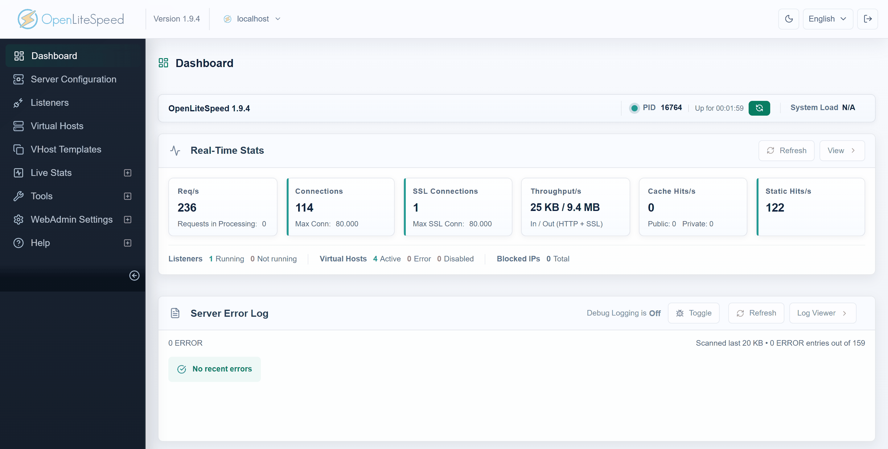
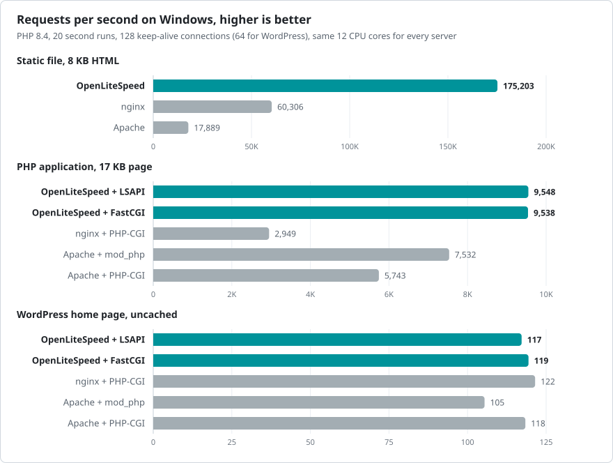

# OpenLiteSpeed for Windows

Website: [openlitespeed.dev/windows](https://openlitespeed.dev/windows/)

A native Windows build of the [OpenLiteSpeed](https://openlitespeed.org) web server 1.9.4. It runs on Windows 10, Windows 11 and Windows Server without WSL, Docker or a virtual machine, serves PHP through LSAPI or FastCGI and installs on its own or inside Laragon and XAMPP. Free and open source under GPL-3.0.



## Features

- Native Win32 program built with Visual C++, with a graphical installer, a tray app and a Windows service
- Uses every CPU core: up to 32 HTTP worker processes on the same ports, restarted automatically after a crash, with zero downtime reload
- PHP 8.2, 8.3, 8.4 and 8.5 through LSAPI (`lsphp.exe` for Windows is included) or FastCGI (`php-cgi.exe`)
- Finds installed PHP versions, Laragon and XAMPP and configures itself for them
- Local development sites: every folder in the projects folder becomes `http://folder.test/`
- HTTP/2, HTTP/3 (QUIC), TLS 1.3, Brotli, LSCache, `.htaccess` rewrite rules and the WebAdmin console
- Hardened for Windows: file names are checked against case, short name, stream and device name tricks, PHP runs with a restricted token and the service runs under a virtual account

## Performance

Requests per second on the same Windows machine with PHP 8.4 and 32 concurrent connections. Every server used the same 12 CPU cores and the same PHP build. Results for PHP 8.2 to 8.5, memory use and the full test setup are in [docs/BENCHMARKS.md](docs/BENCHMARKS.md).

<picture>
  <source media="(prefers-color-scheme: dark)" srcset="docs/bench-overview-dark.svg">
  
</picture>

## Requirements

- Windows 10, Windows 11 or Windows Server 2019 or newer, x64
- PHP 8.2 or newer for Windows, x64. The installer can download it.

## Installation

Download `OpenLiteSpeed-1.9.4-win64-setup.exe` from [Releases](https://github.com/NeuralFoundry/openlitespeed-windows/releases/latest) and run it. Setup shows the PHP versions it found and suggests the setup type.


| Setup type | Install folder | Projects folder | Started by |
|---|---|---|---|
| Standalone server | `C:\OpenLiteSpeed` | `C:\OpenLiteSpeed\www` | Tray app or Windows service |
| Inside Laragon | `C:\laragon\bin\openlitespeed` | Laragon document root | Laragon **Start All** |
| Inside XAMPP | `C:\xampp\openlitespeed` | `C:\xampp\htdocs` | Tray app or Windows service |

The website answers on port 80, or 8088 when port 80 is in use. WebAdmin is at `https://localhost:7080/` with the user `admin` and the password shown at the end of setup. Running setup again on an existing installation upgrades it and keeps the configuration.

Unattended installation:

```bat
OpenLiteSpeed-1.9.4-win64-setup.exe --silent --mode standalone --download-php 8.4 --service
```

| Option | Description |
|---|---|
| `--mode standalone\|laragon\|xampp` | Setup type, detected when omitted |
| `--php <folder>` / `--download-php 8.2\|8.3\|8.4\|8.5` | PHP to use |
| `--dir <folder>` / `--www <folder>` | Install folder / projects folder |
| `--port <n>` / `--admin-port <n>` | Website and WebAdmin ports |
| `--service` / `--no-tray` | Install the Windows service / do not start the tray app |
| `--log <file>` | Log file, `%TEMP%\OpenLiteSpeed-setup.log` by default, includes the admin password |

The same files are available as a zip with `install.ps1` for scripted deployments:

```powershell
powershell -ExecutionPolicy Bypass -File install.ps1 -Mode standalone -DownloadPhp 8.4 -Service
```

To uninstall, use **Settings > Apps** or run `uninstall.exe --uninstall --silent` in the install folder.

## PHP

`lsphp.exe` is the PHP LiteSpeed SAPI built for Windows, for PHP 8.2 to 8.5 in thread safe and non thread safe variants. It runs on top of the official PHP builds from [windows.php.net](https://windows.php.net), so existing extensions and `php.ini` settings keep working. When a PHP version cannot load it, OpenLiteSpeed falls back to `php-cgi.exe` over FastCGI.


Switch the PHP version from the tray menu or with `openlitespeed --set-php <folder>`.

## Multiple CPU cores

OpenLiteSpeed starts one HTTP worker per CPU core, up to 8 by default. Set **Number of Workers** under **Server Configuration > General** in WebAdmin, or `httpdWorkers` in `conf\httpd_config.conf`, to any value from 1 to 32. Each worker has its own PHP pool. See [docs/ARCHITECTURE.md](docs/ARCHITECTURE.md) for how workers share the listening sockets on Windows.

## Command line

Run the commands in the install folder as `bin\openlitespeed.exe`.

| Command | Description |
|---|---|
| `openlitespeed -s start\|stop\|restart\|reload\|status` | Control the server, `reload` is a zero downtime restart |
| `openlitespeed -d` | Run in the foreground |
| `openlitespeed --install-service` / `--uninstall-service` | Register or remove the Windows service |
| `openlitespeed --set-php <folder>` | Use another PHP version |
| `openlitespeed --dev-sites <folder> [tld]` | Create a site for every subfolder of a folder |
| `openlitespeed --dev-hosts` / `--dev-hosts-clear` | Add or remove the site names in the hosts file |
| `openlitespeed --admin-password admin\conf\htpasswd <password>` | Set the WebAdmin password |

The tray app starts, stops and reloads the server, opens the sites, WebAdmin and logs, and switches the PHP version.

## Building from source

See [docs/BUILD.md](docs/BUILD.md). The build uses Visual Studio 2022, CMake and Ninja, and fetches all dependencies at pinned commits.

## Limitations

- No user switching per virtual host (suEXEC). PHP runs as the user that runs the server, or as the service account.
- No `SO_REUSEPORT`. Workers share one listening socket per address.
- cgroups, namespaces, bubblewrap and CageFS are Linux features and are not available.

## Contributing

Bug reports and pull requests are welcome, see [CONTRIBUTING.md](CONTRIBUTING.md). Report security problems privately as described in [SECURITY.md](SECURITY.md).

## License

GPL-3.0, see [LICENSE](LICENSE). OpenLiteSpeed is developed by LiteSpeed Technologies and licensed under GPL-3.0. `lsphp.exe` is built from the PHP sources and covered by the [PHP License](win/lsphp/PHP-LICENSE.txt). Third-party components are listed in [THIRD-PARTY-NOTICES.txt](win/package/THIRD-PARTY-NOTICES.txt).

This project is not affiliated with or endorsed by LiteSpeed Technologies or the PHP Group. LiteSpeed and OpenLiteSpeed are trademarks of LiteSpeed Technologies, Inc.

Also by the same author: [OpenLiteSpeed for cPanel and WHM](https://github.com/NeuralFoundry/openlitespeed-cpanel).
