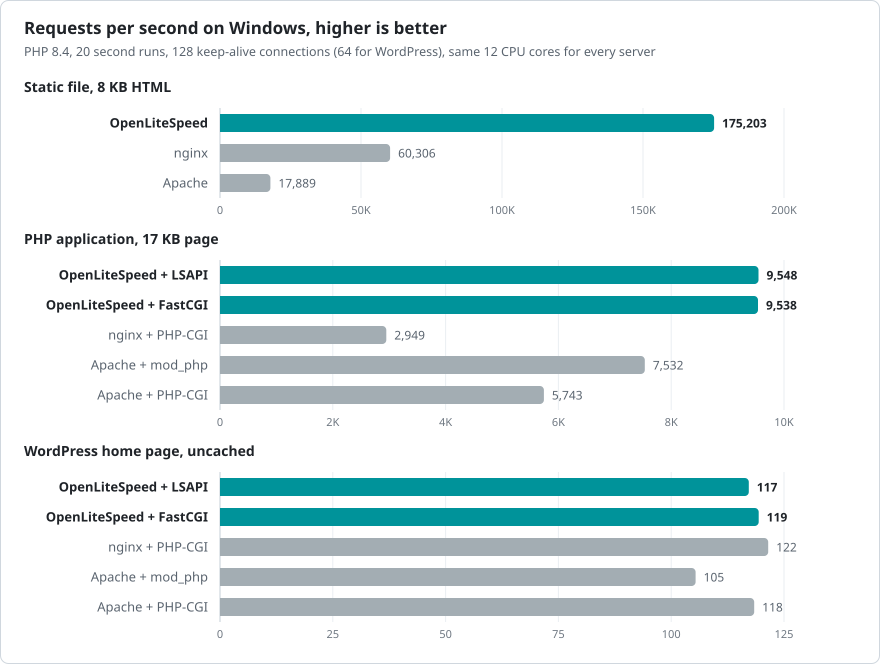
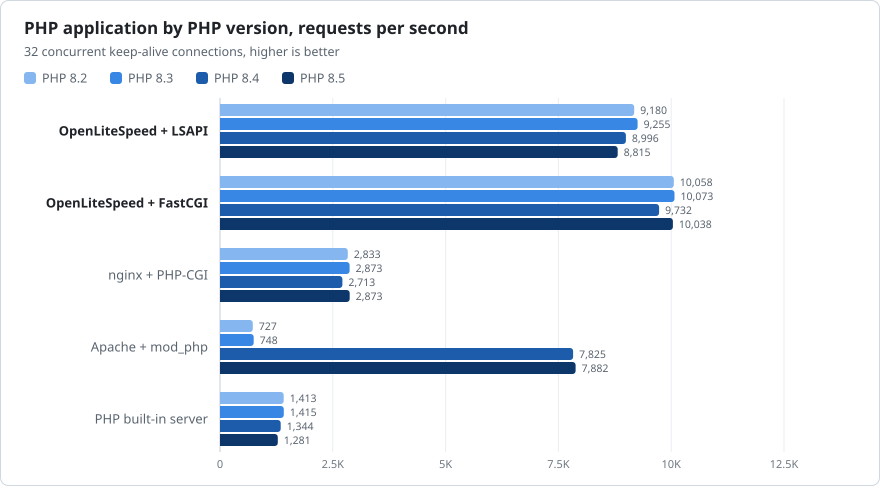

# Benchmarks

OpenLiteSpeed for Windows compared with nginx, Apache and the PHP built-in server on the same Windows machine, with the same PHP builds and the same CPU cores for every server.

<picture>
  <source media="(prefers-color-scheme: dark)" srcset="bench-overview-dark.svg">
  
</picture>

## Results with PHP 8.4

Requests per second with 32 concurrent keep-alive connections. Higher is better.

| Server | Static file | PHP hello world | PHP application |
|---|--:|--:|--:|
| OpenLiteSpeed + LSAPI | 160,384 | 19,731 | 8,996 |
| OpenLiteSpeed + FastCGI |  | 23,498 | 9,732 |
| nginx + PHP-CGI | 52,853 | 3,435 | 2,713 |
| Apache + mod_php | 16,806 | 14,145 | 7,825 |
| PHP built-in server |  | 4,398 | 1,344 |

For the PHP application, OpenLiteSpeed with LSAPI serves 3.3 times the requests of nginx and 1.1 times those of Apache.

## PHP versions

<picture>
  <source media="(prefers-color-scheme: dark)" srcset="bench-versions-dark.svg">
  
</picture>

### PHP 8.2.35

| Server | Hello world, 1 | Hello world, 32 | Hello world, 128 | Application, 1 | Application, 32 | Application, 128 |
|---|--:|--:|--:|--:|--:|--:|
| OpenLiteSpeed + LSAPI | 3,017 | 19,773 | 19,715 | 925 | 9,180 | 8,574 |
| OpenLiteSpeed + FastCGI | 3,400 | 21,508 | 22,844 | 962 | 10,058 | 10,269 |
| nginx + PHP-CGI | 790 | 3,435 | 3,213 | 412 | 2,833 | 2,850 |
| Apache + mod_php | 3,398 | 14,115 | 13,527 | 813 | 727 | 766 |
| PHP built-in server | 2,353 | 4,419 | 4,455 | 949 | 1,413 | 1,496 |

### PHP 8.3.36

| Server | Hello world, 1 | Hello world, 32 | Hello world, 128 | Application, 1 | Application, 32 | Application, 128 |
|---|--:|--:|--:|--:|--:|--:|
| OpenLiteSpeed + LSAPI | 3,256 | 20,434 | 19,331 | 942 | 9,255 | 8,865 |
| OpenLiteSpeed + FastCGI | 3,308 | 21,210 | 20,682 | 960 | 10,073 | 10,204 |
| nginx + PHP-CGI | 549 | 3,428 | 3,359 | 384 | 2,873 | 2,805 |
| Apache + mod_php | 3,049 | 14,043 | 14,139 | 808 | 748 | 793 |
| PHP built-in server | 2,216 | 4,361 | 4,455 | 994 | 1,415 | 1,392 |

### PHP 8.4.27

| Server | Hello world, 1 | Hello world, 32 | Hello world, 128 | Application, 1 | Application, 32 | Application, 128 |
|---|--:|--:|--:|--:|--:|--:|
| OpenLiteSpeed + LSAPI | 2,995 | 19,731 | 19,112 | 856 | 8,996 | 8,949 |
| OpenLiteSpeed + FastCGI | 3,405 | 23,498 | 23,080 | 919 | 9,732 | 9,827 |
| nginx + PHP-CGI | 557 | 3,435 | 3,265 | 364 | 2,713 | 2,736 |
| Apache + mod_php | 3,426 | 14,145 | 13,958 | 836 | 7,825 | 7,441 |
| PHP built-in server | 2,270 | 4,398 | 4,344 | 954 | 1,344 | 1,387 |

### PHP 8.5.12

| Server | Hello world, 1 | Hello world, 32 | Hello world, 128 | Application, 1 | Application, 32 | Application, 128 |
|---|--:|--:|--:|--:|--:|--:|
| OpenLiteSpeed + LSAPI | 3,017 | 19,935 | 18,742 | 893 | 8,815 | 8,689 |
| OpenLiteSpeed + FastCGI | 3,322 | 21,078 | 22,620 | 947 | 10,038 | 10,059 |
| nginx + PHP-CGI | 529 | 3,314 | 3,104 | 418 | 2,873 | 2,812 |
| Apache + mod_php | 3,426 | 14,346 | 13,756 | 824 | 7,882 | 7,397 |
| PHP built-in server | 2,119 | 4,220 | 4,112 | 931 | 1,281 | 1,400 |

Columns give the number of concurrent connections. Values are requests per second.

## Multiple CPU cores

OpenLiteSpeed with 6 HTTP workers against a single worker, PHP 8.4, 32 connections.

| Test | 1 worker | 6 workers | Gain |
|---|--:|--:|--:|
| Static file | 44,240 | 160,384 | 3.6x |
| PHP hello world | 5,507 | 19,731 | 3.6x |
| PHP application | 4,839 | 8,996 | 1.9x |

## Memory

Private memory of all server and PHP processes after the PHP 8.4 run.

| Server | Processes | Memory |
|---|--:|--:|
| OpenLiteSpeed + LSAPI | 29 | 280 MB |
| OpenLiteSpeed + FastCGI | 30 | 299 MB |
| nginx + PHP-CGI | 26 | 234 MB |
| Apache + mod_php | 2 | 404 MB |
| PHP built-in server | 1 | 10 MB |

## How the test was run

- Machine: AMD Ryzen 9 8940HX (16 cores, 32 threads), 48 GB RAM, Windows 11. Everything ran on one machine over 127.0.0.1.
- The web server and its PHP processes were pinned to the same 12 logical cores for every server. The load generator ran on 4 other cores.
- Load: ApacheBench 2.3 with keep-alive (`ab -k`), 4 processes sharing the connections, 5 seconds per run after a warm-up. Each value is the average of 2 runs. Runs with failed or non-200 responses are excluded.
- PHP: official builds from windows.php.net (8.2.35, 8.3.36, 8.4.27, 8.5.12) with the same `php.ini` and OPcache enabled. Non thread safe builds for OpenLiteSpeed, nginx and the built-in server, thread safe builds for Apache, as each server requires.
- OpenLiteSpeed for Windows 1.9.4: 6 HTTP workers and 24 PHP processes, either `lsphp.exe` over LSAPI or `php-cgi.exe` over FastCGI.
- nginx 1.30.6, official Windows build: `open_file_cache` on and 24 `php-cgi.exe` FastCGI processes. One worker process, because the nginx documentation for Windows notes that only one worker actually does any work. nginx opens a new FastCGI connection for every request, because `fastcgi_keep_conn` caused 30 second stalls with `php-cgi.exe` on Windows.
- Apache 2.4.54 (Apache Lounge build shipped with Laragon): `mpm_winnt` with 256 threads, `mod_php`, `AllowOverride None` for the whole file system and default settings otherwise.
- PHP built-in server: `php -S`, which handles one request at a time and is meant for development only.
- Access logging was on for every server.
- Test files: `static.html` is an 8 KB HTML page, `hello.php` prints one line, `app.php` builds and sorts a 200-row array and renders it as a 17 KB HTML table with `json_encode` and `md5`.

## Notes

- Apache with `mod_php` runs the thread safe PHP build. In PHP 8.2 and 8.3 that build converts floating point numbers to strings behind one global lock, so `number_format`, `json_encode` and `serialize` of floats wait for each other across all threads. PHP 8.4 no longer has this bottleneck, which is why Apache gains so much on the application test from PHP 8.4 on. OpenLiteSpeed, nginx and the built-in server run separate non thread safe PHP processes and are not affected.
- Two OpenLiteSpeed LSAPI runs returned one 503 response each, out of about 100,000 requests, and were left out of the averages. It happens when `lsphp.exe` recycles itself and is being fixed.
- These numbers describe Windows. On Linux, nginx uses every core with several workers and the gaps are different.
