[English](../../README.md) | **Türkçe** | [简体中文](README.zh-CN.md) | [Español](README.es.md) | [Português](README.pt-BR.md) | [Русский](README.ru.md) | [日本語](README.ja.md) | [Deutsch](README.de.md) | [Français](README.fr.md) | [한국어](README.ko.md) | [Bahasa Indonesia](README.id.md)

# OpenLiteSpeed for Windows

Web sitesi: [openlitespeed.dev/windows](https://openlitespeed.dev/windows/)

Windows için OpenLiteSpeed, [OpenLiteSpeed](https://openlitespeed.org) 1.9.4 web sunucusunun yerel (native) Windows derlemesidir. WSL, Docker ya da sanal makine olmadan Windows 10, Windows 11 ve Windows Server üzerinde çalışır, PHP'yi LSAPI veya FastCGI ile sunar ve tek başına ya da Laragon ve XAMPP içine kurulur. Full stack sürümü buna bir yönetim paneli, MariaDB, phpMyAdmin ve Cloudflare Tunnel ekler, böylece bilgisayarınızdaki bir site yerel bir IP arkasında olsa bile internete açılabilir. Yönetim panelinden PHP ve Node.js sürümlerini kurar, her siteye kendi PHP sürümünü verir, WordPress, Laravel, Node.js ve Python siteleri oluşturur ve veritabanlarını yönetirsiniz. GPL-3.0 lisansıyla ücretsiz ve açık kaynaktır.

<picture>
  <source media="(prefers-color-scheme: dark)" srcset="../panel-dark.png">
  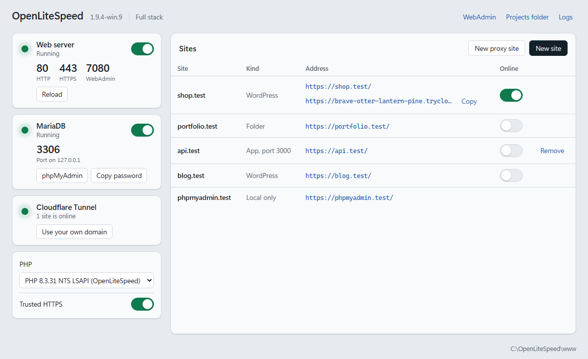
</picture>

## Özellikler

- Visual C++ ile derlenmiş yerel bir Win32 programı; grafik kurulum sihirbazı, sistem tepsisi uygulaması ve Windows hizmetiyle gelir
- Tek kurulum dosyasında iki sürüm: yalnızca web sunucusu ya da yönetim paneli, MariaDB, phpMyAdmin ve Cloudflare Tunnel içeren full stack
- Yönetim paneli: hizmetleri başlatıp durdurmak, site oluşturmak, PHP ve Node.js kurmak, veritabanlarını yönetmek, logları okumak, portları değiştirmek ve siteleri internete açmak için tek pencere
- PHP 7.4 ile 8.5 arası ve Node.js LTS sürümleri yönetim panelinden kurulur ve yayımlanan SHA-256 değerlerine göre doğrulanır
- Her site için ayrı PHP sürümü, bir anahtarla açılıp kapatılan PHP eklentileri ve sık kullanılan `php.ini` ayarları için bir form
- Yeni site türleri: düz PHP sitesi, WordPress, Laravel (Composer ile), Node.js uygulaması veya Python uygulaması
- Veritabanları: kendi kullanıcısıyla veritabanı oluşturma, `.sql` dosyalarını dışa ve içe aktarma, veritabanı silme
- Cloudflare Tunnel ile yerel bir siteyi internete açma: bilgisayarınızdaki siteye port yönlendirme ve genel IP gerekmeden herkese açık bir https adresi. Kendi alan adınız bir tunnel token ile çalışır.
- Yalnızca 127.0.0.1 üzerinde MariaDB 11.8 ve phpMyAdmin 5.2, otomatik üretilen bir root parolasıyla. Her yeni WordPress sitesi kendi veritabanını ve kullanıcısını alır.
- Tüm CPU çekirdeklerini kullanır: aynı portlarda en fazla 32 HTTP worker süreci, çökmeden sonra otomatik yeniden başlatma ve kesintisiz yeniden yükleme
- LSAPI (Windows için `lsphp.exe` dahildir) veya FastCGI (`php-cgi.exe`) üzerinden PHP 8.2, 8.3, 8.4 ve 8.5
- Kurulu PHP sürümlerini, Laragon'u ve XAMPP'yi bulur ve kendini bunlara göre yapılandırır
- Apache sitelerini `httpd.conf` dosyasından içe aktarır: sanal sunucular (virtual host), SSL sertifikaları, yönlendirmeler, alias'lar, proxy'ler, CGI, erişim kuralları ve parola koruması, `.htaccess` dosyalarındaki kurallar dahil
- CGI programları: `.exe`, `.bat` ve `.cmd` dosyaları ve Perl veya Python gibi `#!` satırı olan betikler, her biri kısıtlı bir belirteçle (restricted token) kendi iş nesnesi (job object) içinde çalışır
- Sunucu tarafından başlatılıp yeniden başlatılan Node.js ve Python (WSGI) uygulamaları. Node.js uygulamaları [openlitespeed-node](https://github.com/NeuralFoundry/openlitespeed-node) sayesinde değiştirilmeden, WebSocket'ler dahil çalışır, bkz. [docs/APPS.md](../APPS.md)
- Yerel geliştirme siteleri: projeler klasöründeki her klasör `http://folder.test/` olur. Yeni siteler, istenirse WordPress ile, sistem tepsisinden veya yönetim panelinden oluşturulur
- Yerel siteler için güvenilir HTTPS: bilgisayarınızda oluşturulan ve yalnızca `.test`, `.localhost` ve `.internal` adlarını ve bilgisayarın kendi adresini imzalayabilen bir sertifika yetkilisi
- Yerel bir portta çalışan uygulamalar için proxy siteleri, örneğin `127.0.0.1:3000` üzerindeki bir uygulama için `api.test`
- İmzalı güncellemeler: sistem tepsisi uygulaması yeni sürümü indirir, imzasını doğrular ve siz onaylayınca kurar
- HTTP/2, HTTP/3 (QUIC), TLS 1.3, Brotli, LSCache ve WebAdmin konsolu
- Let's Encrypt'ten ücretsiz HTTPS sertifikaları, yerleşik bir ACME istemcisiyle otomatik alınır ve yenilenir, bkz. [docs/ACME.md](../ACME.md)
- Yerleşik modüller: LSCache, yükleme ilerlemesi, istek gövdesi ayrıştırma ve LuaJIT ile Lua betikleri, bkz. [docs/MODULES.md](../MODULES.md)
- `.htaccess` dosyaları Apache'deki gibi çalışır: rewrite kuralları, erişim kuralları (`Require`, `Order`, `Allow`, `Deny`), parolalar, `<Files>` bölümleri, `Options Indexes` ve `php_flag engine off`; bir dosya değiştiğinde bir saniye içinde uygulanır
- Web uygulaması güvenlik duvarı: OWASP Core Rule Set ile ModSecurity 3, tek komutla açılır, bkz. [docs/PROTECTION.md](../PROTECTION.md#web-application-firewall)
- Bot koruması: reCAPTCHA veya hCaptcha doğrulamaları, istemci IP'si başına istek, bant genişliği ve bağlantı sınırları, PHP ve rewrite kuralları için MaxMind GeoIP2 veya IP2Location veritabanlarından ziyaretçinin ülkesi, bkz. [docs/PROTECTION.md](../PROTECTION.md)
- WordPress için LiteSpeed Cache kurulduğu gibi çalışır: eklentiyi kurup etkinleştirmeniz yeterli, sunucu yapılandırması gerekmez. İçerik değiştiğinde sayfalar önbellekten otomatik temizlenir.
- Windows için sağlamlaştırılmıştır: dosya adları büyük/küçük harf, kısa ad, akış (stream) ve aygıt adı hilelerine karşı denetlenir, PHP kısıtlı bir belirteçle, hizmet ise sanal bir hesapla çalışır

## Performans: Windows için OpenLiteSpeed, nginx ve Apache karşılaştırması

Bu depodaki yerel Windows derlemesi, aynı Windows 11 makinesinde nginx ve Apache ile karşılaştırıldı; PHP 8.4 kullanıldı ve her sunucuya aynı 12 CPU çekirdeği verildi. Değerler saniyedeki istek sayısıdır, yüksek olan daha iyidir. Tüm testler hatasız tamamlandı.

<picture>
  <source media="(prefers-color-scheme: dark)" srcset="../bench-windows-overview-dark.svg">
  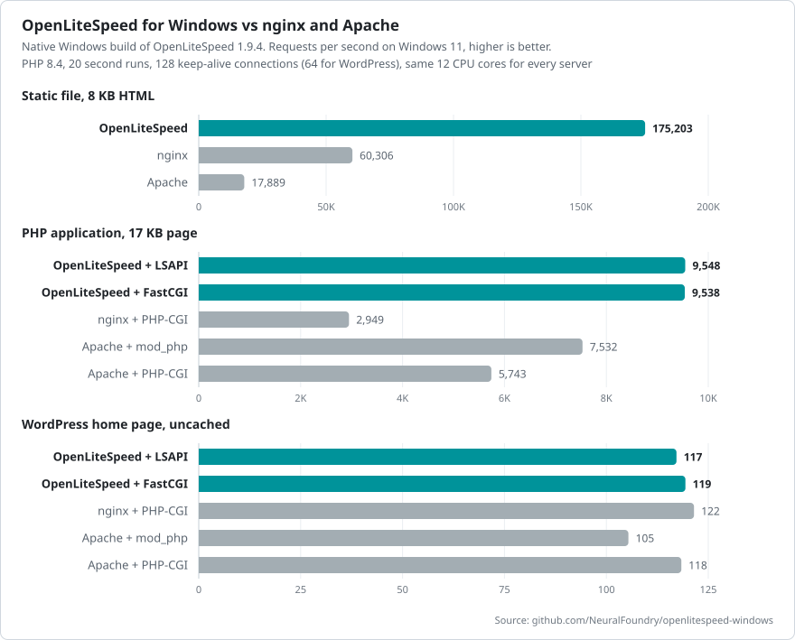
</picture>

| Sunucu | Statik dosya | PHP uygulaması | WordPress, önbelleksiz | HTTPS üzerinden PHP | 512 bağlantıda PHP |
|---|--:|--:|--:|--:|--:|
| OpenLiteSpeed + LSAPI | 175.203 | 9.548 | 117 | 8.687 | 9.434 |
| OpenLiteSpeed + FastCGI |  | 9.538 | 119 | 8.961 | 9.587 |
| nginx + PHP-CGI | 60.306 | 2.949 | 122 | 472 | 462 |
| Apache + mod_php | 17.889 | 7.532 | 105 | 4.473 | 3.078 |
| Apache + PHP-CGI |  | 5.743 | 118 | 4.356 | 5.396 |

Statik dosyalarda PHP devreye girmediği için her sunucuda bir kez ölçüldü. Statik dosya, PHP uygulaması ve WordPress: 128 keep-alive bağlantıyla (WordPress için 64) 20 saniyelik testler. HTTPS: 10 saniye, 128 bağlantı. Son sütun, 512 bağlantıyla kesintisiz süren 60 saniyelik bir yük testinin ortalamasıdır:

<picture>
  <source media="(prefers-color-scheme: dark)" srcset="../bench-windows-stress-app-dark.svg">
  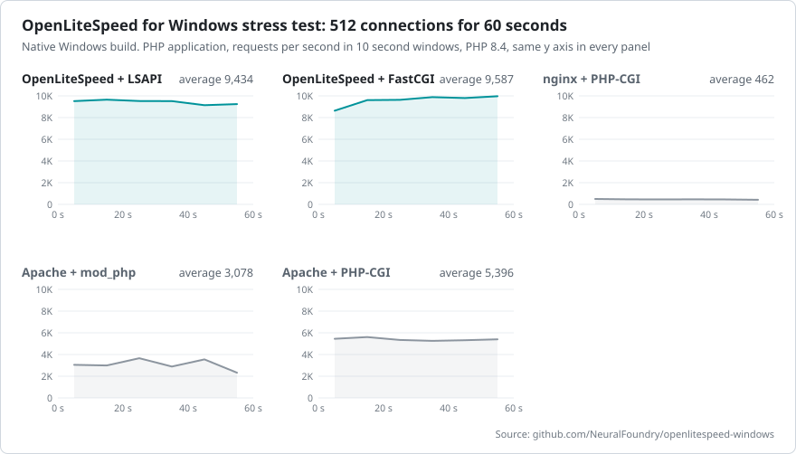
</picture>

Önbelleksiz WordPress her sunucuda yaklaşık aynı hızda çalışır, çünkü işin çoğunu PHP ve MySQL yapar. Sayfa önbelleğiyle tablo değişir. Aynı sitenin ana sayfası, 64 bağlantı:

| Sunucu ve önbellek | İstek/sn | p99 |
|---|--:|--:|
| OpenLiteSpeed + LiteSpeed Cache eklentisi | 21.180 | 6,1 ms |
| Apache + mod_cache_disk | 18.362 | 6,1 ms |
| nginx + fastcgi_cache | 7.745 | 10,8 ms |

Gecikme, bellek kullanımı, test ortamının tamamı ve ham veriler [docs/BENCHMARKS.md](../BENCHMARKS.md) dosyasındadır.

## Gereksinimler

- Windows 10, Windows 11 veya Windows Server 2019 ve üzeri, x64
- Windows için PHP 8.2 veya üzeri, x64. Kurulum programı PHP'yi indirebilir.

## Kurulum

`OpenLiteSpeed-1.9.4-win64-setup.exe` dosyasını [Releases](https://github.com/NeuralFoundry/openlitespeed-windows/releases/latest) sayfasından indirip çalıştırın. Kurulum, bulduğu PHP sürümlerini gösterir, kurulum türünü önerir ve hangi sürümün kurulacağını sorar.

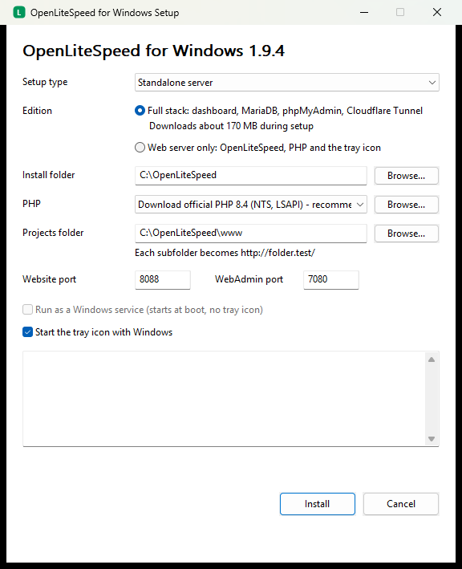

| Sürüm | İçerik |
|---|---|
| Full stack | OpenLiteSpeed, PHP, sistem tepsisi uygulaması, yönetim paneli, MariaDB, phpMyAdmin ve Cloudflare Tunnel. Kurulum yaklaşık 170 MB indirir ve her dosyayı sabitlenmiş bir SHA-256 değerine göre doğrular. |
| Yalnızca web sunucusu | OpenLiteSpeed, PHP ve sistem tepsisi uygulaması; yeni siteler, güvenilir HTTPS, PHP sürümü değiştirme, içe aktarma ve güncellemelerle |

Kurulumu yeniden çalıştırmak sürümü değiştirir. Yalnızca web sunucusu sürümüne geçildiğinde veritabanlarınız korunur. Full stack sürümü sistem tepsisi uygulamasıyla çalışır, bu yüzden Windows hizmeti seçeneği yalnızca web sunucusu sürümü içindir.

Kurulum, kurulum klasörüne erişimi hesabınız, yöneticiler ve sistemle sınırlar; böylece bilgisayarın diğer kullanıcıları programları veya yapılandırmayı değiştiremez. Laragon ve XAMPP klasörlerine ise dokunmaz; bunların PHP klasörlerini çoğu zaman diğer kullanıcılar da değiştirebilir. Windows hizmetiyle bu, onların hizmet hesabıyla kod çalıştırmasına olanak verir, bu yüzden hizmet kurulumu bu tür PHP klasörleri için uyarı verir.

| Kurulum türü | Kurulum klasörü | Projeler klasörü | Başlatan |
|---|---|---|---|
| Bağımsız sunucu | `C:\OpenLiteSpeed` | `C:\OpenLiteSpeed\www` | Sistem tepsisi uygulaması veya Windows hizmeti |
| Laragon içinde | `C:\laragon\bin\openlitespeed` | Laragon belge kök dizini | Laragon **Start All** |
| XAMPP içinde | `C:\xampp\openlitespeed` | `C:\xampp\htdocs` | Sistem tepsisi uygulaması veya Windows hizmeti |

Web sitesi 80 numaralı portta, bu port kullanılıyorsa 8088'de yanıt verir. WebAdmin `https://localhost:7080/` adresindedir; kullanıcı adı `admin`, parola ise kurulumun sonunda gösterilen paroladır. Mevcut bir kurulumda kurulumu yeniden çalıştırmak onu yükseltir ve yapılandırmayı korur.


Gözetimsiz kurulum:

```bat
OpenLiteSpeed-1.9.4-win64-setup.exe --silent --mode standalone --download-php 8.4 --edition full
```

| Seçenek | Açıklama |
|---|---|
| `--mode standalone\|laragon\|xampp` | Kurulum türü, verilmezse otomatik algılanır |
| `--edition server\|full` | Sürüm; verilmezse yeni kurulumda `server`, yükseltmede mevcut sürüm. `--service` için `server` gerekir |
| `--php <folder>` / `--download-php 8.2\|8.3\|8.4\|8.5` | Kullanılacak PHP |
| `--dir <folder>` / `--www <folder>` | Kurulum klasörü / projeler klasörü |
| `--port <n>` / `--admin-port <n>` | Web sitesi ve WebAdmin portları |
| `--service` / `--no-tray` | Windows hizmetini kur / sistem tepsisi uygulamasını başlatma |
| `--log <file>` | Log dosyası, varsayılan olarak `%TEMP%\OpenLiteSpeed-setup.log`, yönetici parolasını içerir |

Aynı dosyalar, betikle yapılan dağıtımlar için `install.ps1` ile birlikte bir zip olarak da sunulur. Kurulum programı gibi bu betik de, klasör izinlerini hâlâ üst klasörden alıyorsa kurulum klasörüne erişimi hesabınız, yöneticiler ve sistemle sınırlar:

```powershell
powershell -ExecutionPolicy Bypass -File install.ps1 -Mode standalone -DownloadPhp 8.4 -Edition full
```

Kaldırmak için **Ayarlar > Uygulamalar** bölümünü kullanın veya kurulum klasöründe `uninstall.exe --uninstall --silent` komutunu çalıştırın. Projeler klasörü ve veritabanlarını içeren `data` klasörü silinmez.

## Yönetim paneli

Full stack sürümünde yönetim paneli Başlat menüsünden veya sistem tepsisi simgesine çift tıklanarak açılır. Bir web sayfası değil, masaüstü penceresidir; bu yüzden hiçbir portu dinlemez. Sayfalar:

| Sayfa | Neler yapabilirsiniz |
|---|---|
| Overview | Web sunucusunu, MariaDB'yi ve Cloudflare Tunnel'ı başlatma ve durdurma, saniyedeki istekleri ve açık bağlantıları görme |
| Sites | Site oluşturma ve silme, her sitenin PHP veya Node.js sürümünü seçme, bir siteyi internete açma, klasörünü ya da içinde bir terminal veya VS Code açma, bir klasörü Node.js veya Python uygulaması olarak çalıştırma, arka plan işleri çalıştırma |
| PHP | PHP sürümlerini kurma, varsayılanı seçme, eklentileri ve Xdebug'ı açıp kapatma, `php.ini` ayarlarını değiştirme, Composer kurma |
| Node.js | Node.js sürümlerini kurma, uygulamaları çalıştıracak sürümü seçme, bir uygulamayı yeniden başlatma ve logunu okuma |
| Databases | Bir veritabanı ve kullanıcısını oluşturma, `.sql` dosyalarını dışa ve içe aktarma, veritabanı silme, phpMyAdmin'i açma |
| Mail | Mail yakalayıcıyı açıp kapatma, yakalanan postaları HTML bölümü ve ekleriyle okuma |
| Logs | Sunucu, MariaDB, uygulama ve tunnel loglarını okuma, satırları filtreleme, yeni satırları canlı izleme |
| Settings | Windows ile başlatma, projeler klasörü, güvenilir HTTPS, HTTP ve WebAdmin portları ve WebAdmin parolası |

Sol alttaki **Terminal**, `PATH` üzerinde varsayılan PHP, Composer, Node.js ve MariaDB istemcisi bulunan bir komut istemi açar.

<picture>
  <source media="(prefers-color-scheme: dark)" srcset="../panel-sites-dark.png">
  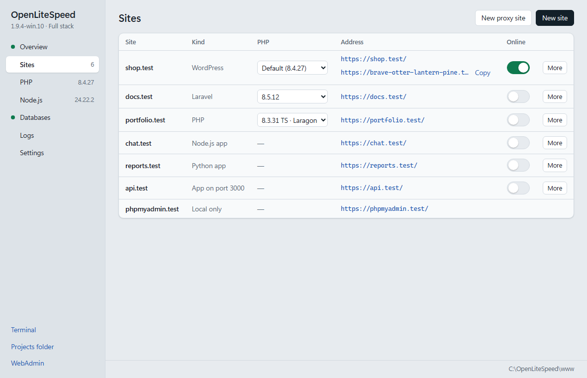
</picture>

Yönetim paneli, Windows 11 ve güncel Windows 10 ile birlikte gelen Microsoft Edge WebView2 Runtime'ı gerektirir.

## Yerel siteler

Projeler klasöründeki her klasör `http://folder.test/` adresinde bir sitedir. Yönetim panelindeki veya sistem tepsisindeki **New site** klasörü oluşturur. Yönetim paneli şu site türlerini sunar:

| Tür | Ne elde edersiniz |
|---|---|
| PHP sitesi | `index.php` içeren bir klasör |
| WordPress | En son WordPress. MariaDB kuruluysa site için bir veritabanı ve kullanıcı ile doldurulmuş bir `wp-config.php`; böylece WordPress kurulumu yalnızca site başlığını ve bir yönetici hesabını sorar |
| Laravel | `composer create-project` ile oluşturulan yeni bir Laravel projesi, `public` klasöründen sunulur |
| Node.js uygulaması | Küçük bir `server.js` ve `package.json`, sunucu tarafından varsayılan Node.js ile başlatılır |
| Python uygulaması | Bir WSGI `wsgi.py`, sunucu tarafından bilgisayarda bulunan Python ile başlatılır |

WordPress kurulum sayfası yalnızca bu bilgisayardan açılır, böylece ağdaki başka biri kurulumu sizden önce tamamlayamaz. `package.json` içeren bir klasör **More > Run as a Node.js app** ile Node.js uygulamasına dönüşür, **Run as a PHP site** onu eski haline getirir. **Remove site** klasörü Geri Dönüşüm Kutusu'na taşır ve veritabanlarını korur.

**New proxy site**, yerel bir portu dinleyen bir uygulamaya kendi adını verir, örneğin 5173 portundaki bir Vite geliştirme sunucusu için `app.test`. WebSocket bağlantıları iletilir. Proxy sitesi, arkasındaki uygulama gibi yalnızca bu bilgisayara yanıt verir.

<picture>
  <source media="(prefers-color-scheme: dark)" srcset="../panel-site-dark.png">
  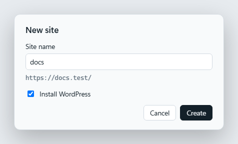
</picture>
<picture>
  <source media="(prefers-color-scheme: dark)" srcset="../panel-proxy-dark.png">
  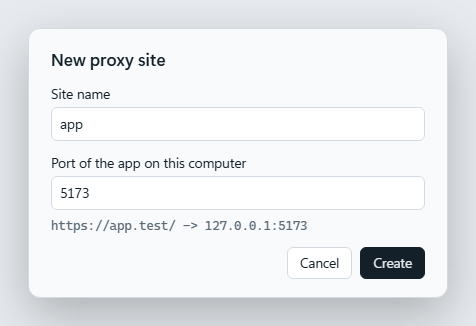
</picture>

## Bir siteyi internete açma

Yönetim panelinde bir sitenin yanındaki **Online** anahtarını açın veya `openlitespeed --tunnel start <site>` komutunu çalıştırın. Cloudflare siteye, siz kapatana kadar herkesin açabileceği rastgele bir `https://*.trycloudflare.com` adresi verir. Bağlantı bilgisayarınızdan dışarıya doğru kurulduğu için NAT, router veya yerel IP arkasında da çalışır ve güvenlik duvarında hiçbir şey açılmaz. Ziyaretçilerin kendi IP adresleri loglarda ve PHP'de korunur. Herkese açık adres yerel adresin altında, yanında **Copy** düğmesiyle gösterilir.

Kendi alan adınız için Cloudflare Zero Trust'ta bir tunnel oluşturun, public hostname'ini web sitesi portundaki `http://127.0.0.1` adresine HTTP host başlığı site adı olacak şekilde yönlendirin ve tunnel token'ını yönetim panelinde **Use your own domain** altına yapıştırın. Token, Windows hesabınız için şifrelenerek saklanır.

<picture>
  <source media="(prefers-color-scheme: dark)" srcset="../panel-share-dark.png">
  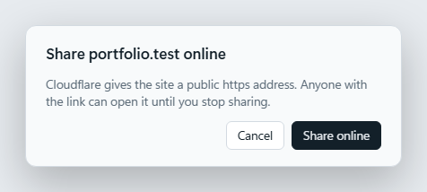
</picture>
<picture>
  <source media="(prefers-color-scheme: dark)" srcset="../panel-token-dark.png">
  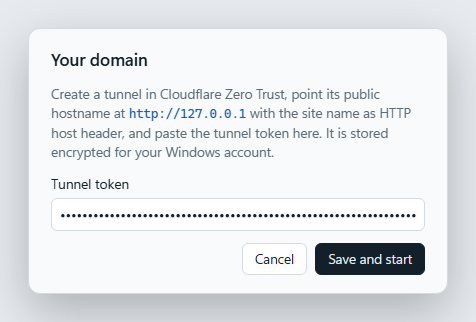
</picture>

Yalnızca projeler klasöründeki siteler ve proxy siteleri internete açılabilir. Bir proxy sitesini paylaşmak tunnel'ı doğrudan uygulamasına bağlar; kendi alan adınızı kullanıyorsanız o hostname'i de uygulamanın portuna yönlendirin. phpMyAdmin ve WebAdmin yalnızca bu bilgisayara yanıt verir ve sunucu ziyaretçilerini bu bilgisayardan ayırt edemiyorsa tunnel başlamaz.

## Veritabanları

MariaDB yalnızca `127.0.0.1` üzerinde dinler ve hiçbir zaman yönetici olarak değil, sizin hesabınızla çalışır. Kurulum MariaDB'yi indirir, sistem tepsisi uygulaması da ilk açılışta veritabanlarını oluşturur. Root parolası o sırada üretilir ve yalnızca hesabınızın ve yöneticilerin okuyabildiği `data\client.cnf` dosyasında saklanır. `SELECT ... INTO OUTFILE` ve `LOAD DATA` yalnızca `data\files` içinde çalışır. Yönetim panelindeki veya sistem tepsisindeki **Copy password** parolayı pano geçmişine eklemeden panoya kopyalar. phpMyAdmin `http://phpmyadmin.test/` adresindedir ve yalnızca bu bilgisayardan açılır.

Sistem tepsisinden veya yönetim panelinden oluşturulan bir WordPress sitesi kendi veritabanını ve kullanıcısını alır ve `wp-config.php` doldurulur.

**Databases** sayfasında **New database**, aynı adda bir kullanıcı ve üretilmiş bir parolayla bir veritabanı oluşturur; parola bir kez, **Copy** düğmesiyle gösterilir. **Export**, `mariadb-dump` ile bir `.sql` dosyası yazar, **Import** bir `.sql` dosyasını veritabanına yükler, **Remove** ise önce adı yazmanızı ister ve kullanıcıyı da silebilir.

<picture>
  <source media="(prefers-color-scheme: dark)" srcset="../panel-db-dark.png">
  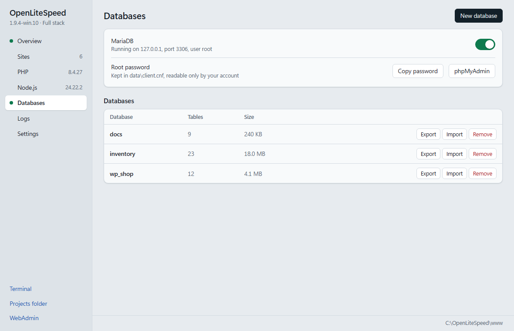
</picture>

## Güvenilir HTTPS

Yönetim panelindeki veya sistem tepsisindeki **Trusted HTTPS** ya da `openlitespeed --dev-https on` komutu bilgisayarınızda bir sertifika yetkilisi oluşturur, Windows'tan hesabınız için ona güvenmesini ister ve her yerel siteyi `https://name.test/` adresinde sunar. Yetkili, ad kısıtlamalarıyla (name constraints) `.test`, `.localhost` ve `.internal` adlarına ve `127.0.0.1` ile `::1` adreslerine sınırlıdır; bu yüzden başka hiçbir site için sertifika imzalayamaz. Kapatıldığında Windows güven deposundan kaldırılır.

## PHP

`lsphp.exe`, Windows için derlenmiş PHP LiteSpeed SAPI'dir ve PHP 8.2 ile 8.5 arası için thread safe ve non thread safe olarak sunulur. [windows.php.net](https://windows.php.net) adresindeki resmi PHP derlemelerinin üzerinde çalışır, bu yüzden mevcut eklentiler ve `php.ini` ayarları çalışmaya devam eder. Bir PHP sürümü onu yükleyemezse OpenLiteSpeed FastCGI üzerinden `php-cgi.exe` kullanır.

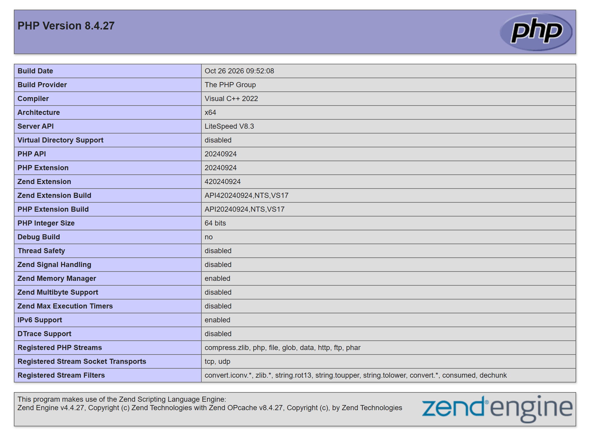

PHP sürümünü yönetim panelinden, sistem tepsisi menüsünden veya `openlitespeed --set-php <folder>` komutuyla değiştirin.

PHP sayfasındaki **Install PHP**, windows.php.net'teki 7.4'ten 8.5'e kadar thread safe ve non thread safe sürümleri listeler. İndirilen dosya windows.php.net'in yayımladığı SHA-256 değerine göre doğrulanır, `php\<version>` klasörüne açılır ve yaygın eklentileri açık bir `php.ini` alır. 8.2 ve sonraki sürümler LSAPI, daha eskileri FastCGI üzerinden çalışır.

Her site kendi PHP sürümünü kullanabilir: Sites sayfasının PHP sütunundan seçin veya `openlitespeed --site php <site> <folder>` komutunu çalıştırın. Seçim yapılmayan siteler varsayılanı kullanır. Her sürüm için **More** menüsünde, o PHP'nin her eklentisi için bir anahtar içeren **Extensions** ve bellek sınırı, yükleme ve POST boyutu, çalışma süresi, girdi değişkenleri, hata gösterimi ve saat dilimi için **Settings** bulunur. **Edit php.ini** dosyayı Not Defteri'nde açar. Değişiklikler web sunucusunu yeniden yükler.

<picture>
  <source media="(prefers-color-scheme: dark)" srcset="../panel-php-dark.png">
  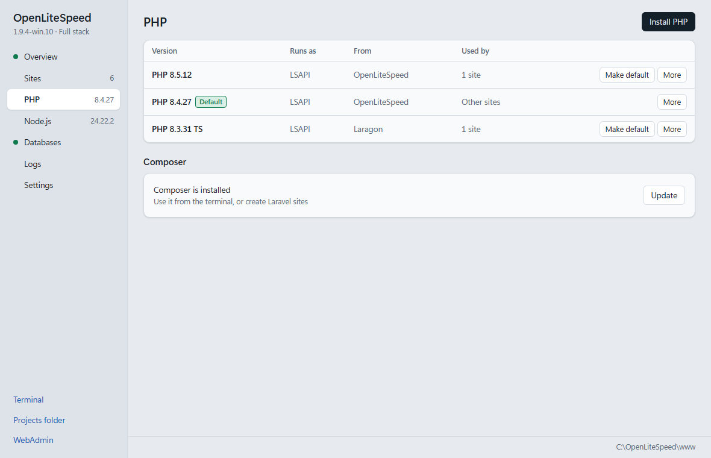
</picture>

Composer altındaki **Install**, `composer.phar` dosyasını getcomposer.org'dan indirir ve SHA-256 değerine göre doğrular. Yönetim paneli terminalinde `composer` komutu `PATH` üzerindedir ve Laravel siteleri onunla oluşturulur.

## Xdebug

PHP sayfasının Xdebug sütunundaki anahtar veya `openlitespeed --php xdebug <folder> on` komutu, o PHP sürümü için Xdebug'ı açar. `ext` klasöründen zaten yüklenen bir Xdebug varsa o kullanılır. Yoksa o PHP sürümünün resmi Windows derlemesi xdebug.org'dan indirilir ve OpenLiteSpeed içinde tutulan bir SHA-256 değerine göre doğrulanır: PHP 8.2 ile 8.5 arası için thread safe ve non thread safe Xdebug 3.5.3.

Xdebug her istekte başlar ve `127.0.0.1:9003` üzerindeki bir hata ayıklayıcıya bağlanır. Hata ayıklayıcı yoksa istek hemen devam eder ve loglara hiçbir şey yazılmaz. Xdebug açıkken opcache JIT kapalıdır, Xdebug kapatılınca geri gelir. Ayarlar `php.ini` dosyasının sonunda tutulur ve uygulanmaları için web sunucusu yeniden yüklenir.

OpenLiteSpeed Windows hizmeti olarak kuruluyken Xdebug açılamaz. Bilgisayarda 9003 portunu dinleyen herhangi bir program hata ayıklama oturumunu alır ve hizmet hesabıyla PHP kodu çalıştırabilir, bu yüzden hizmeti kurmadan önce Xdebug'ı kapatın.

**VS Code:** Sites sayfasındaki **More > Open in VS Code**, VS Code kuruluysa site klasörünü VS Code'da açar. 9003 portunu dinleyen bir PHP hata ayıklama oturumu başlatın (örneğin PHP Debug eklentisiyle) ve siteyi tarayıcıda açın.

## Mail yakalayıcı

Mail sayfasındaki anahtar veya `openlitespeed --mail on` komutu, yerel sitelerin gönderdiği her postayı yakalar, böylece hiçbir posta bilgisayardan çıkmaz. PHP `mail()`, OpenLiteSpeed'in çalıştırdığı PHP sürümlerinin `php.ini` dosyasındaki `sendmail_path` üzerinden OpenLiteSpeed'e gider; SMTP ile gönderen uygulamalar `127.0.0.1` sunucusunu, 1025 portunu, şifrelemesiz bağlantıyı ve herhangi bir kullanıcı adı ile parolayı kullanır. Yeni Laravel siteleri bu ayarları `.env` dosyasında alır. Web isteği gibi başlayan bir bağlantı kapatılır, böylece tarayıcıdaki bir web sayfası yakalayıcıya posta gönderemez.

Postalar, yalnızca hesabınızın okuyabildiği `data\mail` klasöründe en yeni 1000 ileti ve 512 MB ile sınırlı olarak tutulur. Mail sayfası her iletiyi metin ve HTML bölümleriyle gösterir ve ekleri kaydetmenizi sağlar. HTML bölümü betikler olmadan çalışır ve internetten hiçbir şey yüklemez.

## Arka plan işleri

Bir sitenin **More** menüsündeki **Background jobs** veya `openlitespeed --job add <site> <name> <command>` komutu, `php artisan queue:work`, `php artisan schedule:work` ya da `npm run dev` gibi uzun süre çalışan bir komutu site klasöründe, o sitenin PHP ve Node.js sürümleri `PATH` üzerinde en önde olacak şekilde çalıştırır. İşler web sunucusuyla birlikte başlar ve durur. Sona eren bir iş 1, 2, 4 ve en fazla 60 saniye sonra yeniden başlatılır; 10 dakika içinde 10 kez yeniden başlatılan bir iş durdurulmuş olarak kalır. Bir işi durdurmak, başlattığı tüm süreçleri sonlandırır. Çıktı, Logs sayfasında görünen `logs\jobs\<site>.<name>.log` dosyasına yazılır. Windows hizmetiyle kullanıldığında işleri ve mail yakalayıcıyı, PHP'de olduğu gibi hizmet hesabı çalıştırır.

## Node.js

Node.js sayfasındaki **Install Node.js**, nodejs.org'daki Current ve LTS sürümleri listeler. İndirilen dosya `SHASUMS256.txt` ile doğrulanır ve `node\<version>` klasörüne açılır. Sayfa ayrıca `Program Files`, Laragon, nvm, Volta ve `PATH` üzerinde bulunan Node.js kurulumlarını da listeler. **Make default**, Node.js uygulamalarını çalıştıracak sürümü seçer; uygulamalar altta **Restart** ve **Log** ile listelenir.

<picture>
  <source media="(prefers-color-scheme: dark)" srcset="../panel-node-dark.png">
  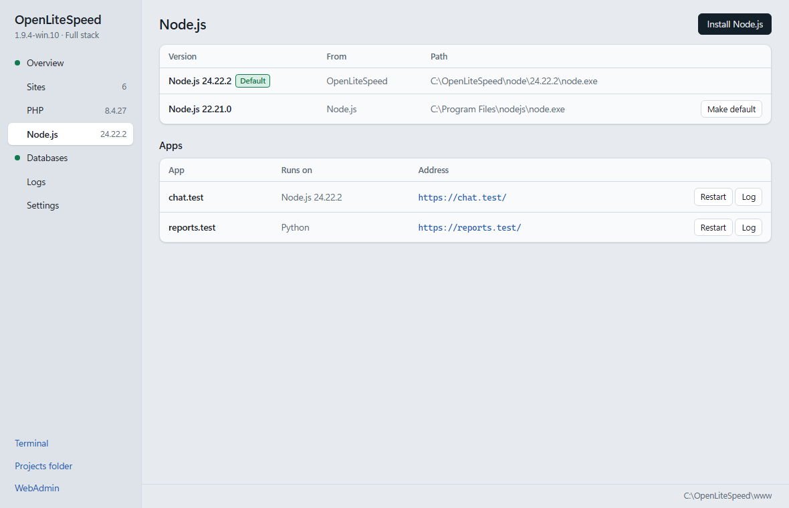
</picture>

Bir Node.js uygulamasında değişiklik gerekmez: `app.listen(3000)`, sunucunun verdiği adrese yönlendirilir. Bkz. [docs/APPS.md](../APPS.md).

Her site kendi Node.js sürümünü kullanabilir: Sites sayfasının Version sütunundan seçin veya `openlitespeed --site node <site> <node.exe>` komutunu çalıştırın. Seçim yoksa `20` gibi bir ana sürüm belirten `.nvmrc` ya da `.node-version` dosyası kurulu en yeni Node.js 20'yi seçer, aksi halde site varsayılan sürümle çalışır. Sitenin arka plan işleri ve terminali de aynı sürümü kullanır.

## Apache'den geçiş

OpenLiteSpeed mevcut bir Apache yapılandırmasını okur ve her `<VirtualHost>` için alan adları, belge kök dizini, SSL sertifikası, yönlendirmeler, rewrite kuralları, alias'lar, proxy'ler, erişim kuralları ve parola korumasıyla birlikte bir site oluşturur. `.htaccess` dosyalarındaki kurallar çalışmaya devam eder, çünkü OpenLiteSpeed onları kendisi uygular.

```bat
bin\openlitespeed.exe --import-apache --dry-run
bin\openlitespeed.exe --import-apache C:\Apache24\conf\httpd.conf
bin\openlitespeed.exe -s reload
```

Yol verilmezse Laragon, XAMPP, WampServer veya `C:\Apache24` Apache yapılandırması otomatik bulunur. `--dry-run` hiçbir şeyi değiştirmeden raporu yazdırır. Yeniden içe aktarma öncekinin yerini alır, `--import-apache --remove` ise onu kaldırır. Dönüştürülemeyen kurallar raporda listelenir. Erişim kuralları birebir ya da daha sıkı dönüştürülür, hiçbir zaman daha serbest değil; tek istisna olan, belirli istemcileri host adına veya ortam değişkenine göre engelleyen kurallar uyarı olarak bildirilir. Ayrıntılar [docs/APACHE.md](../APACHE.md) dosyasındadır.

## nginx'ten geçiş

`--import-nginx` aynısını nginx için yapar: her `server` bloğu alan adları, dinleyicileri, SSL sertifikası, location'ları, `try_files`, rewrite'ları, yönlendirmeleri, alias'ları, proxy'leri, erişim kuralları ve parola korumasıyla bir site olur ve `fastcgi_pass` arkasındaki PHP, OpenLiteSpeed'in PHP'si üzerinden çalışır.

```bat
bin\openlitespeed.exe --import-nginx --dry-run
bin\openlitespeed.exe --import-nginx C:\nginx\conf\nginx.conf
```

Ayrıntılar [docs/NGINX.md](../NGINX.md) dosyasındadır.

## Birden çok CPU çekirdeği

OpenLiteSpeed her CPU çekirdeği için bir HTTP worker başlatır, varsayılan olarak en fazla 8. WebAdmin'de **Server Configuration > General** altındaki **Number of Workers** değerini veya `conf\httpd_config.conf` içindeki `httpdWorkers` değerini 1 ile 32 arasında istediğiniz bir sayıya ayarlayın. Her worker'ın kendi PHP havuzu vardır. Worker'ların Windows'ta dinleme soketlerini nasıl paylaştığı için [docs/ARCHITECTURE.md](../ARCHITECTURE.md) dosyasına bakın.

## Komut satırı

Komutları kurulum klasöründe `bin\openlitespeed.exe` olarak çalıştırın.

| Komut | Açıklama |
|---|---|
| `openlitespeed -s start\|stop\|restart\|reload\|status` | Sunucuyu yönetir, `reload` kesintisiz bir yeniden başlatmadır |
| `openlitespeed -d` | Ön planda çalıştırır |
| `openlitespeed --install-service` / `--uninstall-service` | Windows hizmetini kaydeder veya kaldırır |
| `openlitespeed --set-php <folder>` | Başka bir PHP sürümü kullanır |
| `openlitespeed --import-apache [httpd.conf] [--dry-run]` / `--import-apache --remove` | Apache sitelerini içe aktarır / içe aktarılan siteleri kaldırır |
| `openlitespeed --import-nginx [nginx.conf] [--dry-run]` / `--import-nginx --remove` | nginx sitelerini içe aktarır / içe aktarılan siteleri kaldırır |
| `openlitespeed --acme-install [--email <address>]` | Otomatik Let's Encrypt sertifikalarını açar |
| `openlitespeed --modsec-install [--detection-only]` / `--modsec-install --remove` | OWASP Core Rule Set ile ModSecurity güvenlik duvarını açar veya kapatır |
| `openlitespeed --dev-sites <folder> [tld]` | Bir klasörün her alt klasörü için bir site oluşturur |
| `openlitespeed --new-site <name> [--wordpress\|--laravel\|--node\|--python]` | Projeler klasöründe bir site oluşturur: PHP sitesi, veritabanıyla WordPress, Laravel projesi, Node.js uygulaması veya Python uygulaması |
| `openlitespeed --site php <site> <folder>\|default` | Tek bir site için başka bir PHP sürümü kullanır |
| `openlitespeed --site app <site> node\|python\|off` | Bir site klasörünü Node.js veya Python uygulaması olarak ya da yeniden PHP sitesi olarak çalıştırır |
| `openlitespeed --site node <site> <node.exe>\|default` | Tek bir site için başka bir Node.js sürümü kullanır |
| `openlitespeed --php list` | Bu bilgisayardaki PHP sürümlerini, her birinin siteleri ve Xdebug durumuyla JSON olarak verir |
| `openlitespeed --php available` / `install <8.x> [ts]` / `remove <folder>` | windows.php.net'teki PHP sürümlerini listeler ve kurar, indirilmiş bir sürümü kaldırır |
| `openlitespeed --php ext <folder>` / `ext-set <folder> <name> on\|off` | Bir PHP sürümünün eklentilerini listeler, birini açar veya kapatır |
| `openlitespeed --php ini <folder>` / `ini-set <folder> <key> <value>` | Sık kullanılan bir `php.ini` ayarını okur veya değiştirir |
| `openlitespeed --php xdebug <folder> on\|off\|status` | Bir PHP sürümü için Xdebug'ı açar veya kapatır ya da açık olup olmadığını gösterir |
| `openlitespeed --node list\|available` / `install <major>` / `default <node.exe>` / `remove <node.exe>` | Uygulamalar için Node.js sürümlerini yönetir |
| `openlitespeed --composer install` | Composer'ı `tools\composer` içine indirir |
| `openlitespeed --set-port http\|admin <port>` | Web sitesi veya WebAdmin portunu değiştirir |
| `openlitespeed --proxy add <name> <port>` / `remove <name>` / `list` | Yerel bir porttaki uygulama için proxy sitesi ekler veya kaldırır |
| `openlitespeed --dev-https on [port]\|off\|status` | Yerel siteler için güvenilir HTTPS |
| `openlitespeed --dev-hosts` / `--dev-hosts-clear` | Site adlarını hosts dosyasına ekler veya kaldırır |
| `openlitespeed --db install\|fetch\|start\|stop\|status` | MariaDB ve phpMyAdmin'i kurar, yalnızca indirir, başlatır veya durdurur |
| `openlitespeed --db list` / `create <name> [--no-user]` / `drop <name> [--user]` | Veritabanlarını listeler, oluşturur veya siler |
| `openlitespeed --db export <name> <file.sql>` / `import <name> <file.sql>` | Bir veritabanını dosyaya aktarır veya bir dosyayı veritabanına aktarır |
| `openlitespeed --tunnel start <site>` / `stop <site>` / `stop --all` / `status` | Bir siteyi Cloudflare Tunnel ile internete açar veya kapatır |
| `openlitespeed --tunnel token` / `run` / `run-stop` / `token clear` | Standart girdiden bir tunnel token kaydeder, kendi alan adınızı bağlar veya bağlantısını keser, token'ı unutur |
| `openlitespeed --mail on\|off\|status` | Mail yakalayıcıyı açar veya kapatır ya da çalışıp çalışmadığını gösterir |
| `openlitespeed --mail list` / `remove <id>` / `save <id> <n> <file>` / `clear` | Yakalanan postaları JSON olarak listeler, bir iletiyi siler, bir iletinin `n` numaralı ekini (0'dan başlayarak) dosyaya kaydeder veya tüm iletileri siler |
| `openlitespeed --mail sendmail [-t] [-i] [-f <from>] [<recipient>...]` | Standart girdiden gelen bir iletiyi sendmail gibi saklar |
| `openlitespeed --job list` / `add <site> <name> <command>` / `remove <site> <name>` | Sitelerin arka plan işlerini listeler, ekler veya kaldırır |
| `openlitespeed --job start\|stop\|restart <site> <name>` / `autostart <site> <name> on\|off` | Bir işi yönetir, web sunucusuyla birlikte başlayıp başlamayacağını seçer |
| `openlitespeed --status` | Sunucu, PHP, siteler, veritabanı ve tunnel'lar JSON olarak |
| `openlitespeed --admin-password admin\conf\htpasswd <password>` | WebAdmin parolasını ayarlar |

Sistem tepsisi uygulaması sunucuyu başlatır, durdurur ve yeniden yükler, siteleri, WebAdmin'i ve logları açar, site ve proxy sitesi oluşturur, güvenilir HTTPS'i açıp kapatır, PHP sürümünü değiştirir ve Apache ile nginx sitelerini içe aktarır. Full stack sürümünde ayrıca yönetim panelini açar ve MariaDB'yi yönetir. Günde bir kez GitHub'da yeni sürüm olup olmadığını denetler; **Update** yeni sürümü indirir, imzasını ve sağlama toplamını doğrular ve yeni kurulumu çalıştırır. `conf\olstray.ini` içinde `[update]` altındaki `check=0` bu denetimi kapatır.

## Kaynaktan derleme

Bkz. [docs/BUILD.md](../BUILD.md). Derleme Visual Studio 2022, CMake ve Ninja kullanır ve tüm bağımlılıkları sabitlenmiş commit'lerden indirir.

## Sınırlamalar

- Sanal sunucu başına kullanıcı değiştirme (suEXEC) yoktur. PHP, sunucuyu çalıştıran kullanıcıyla veya hizmet hesabıyla çalışır.
- `SO_REUSEPORT` yoktur. Worker'lar her adres için tek bir dinleme soketini paylaşır.
- cgroups, namespaces, bubblewrap ve CageFS Linux özellikleridir ve kullanılamaz.
- App Server bağlamı üzerinden Ruby uygulamaları desteklenmez.

## Katkıda bulunma

Hata bildirimleri ve pull request'ler memnuniyetle karşılanır, bkz. [CONTRIBUTING.md](../../CONTRIBUTING.md). Güvenlik sorunlarını [SECURITY.md](../../SECURITY.md) dosyasında anlatıldığı gibi gizli olarak bildirin.

## Lisans

GPL-3.0, bkz. [LICENSE](../../LICENSE). OpenLiteSpeed, LiteSpeed Technologies tarafından geliştirilir ve GPL-3.0 ile lisanslanır. `lsphp.exe` PHP kaynak kodundan derlenir ve [PHP License](../../win/lsphp/PHP-LICENSE.txt) kapsamındadır. Üçüncü taraf bileşenler [THIRD-PARTY-NOTICES.txt](../../win/package/THIRD-PARTY-NOTICES.txt) dosyasında listelenir.

Bu proje LiteSpeed Technologies veya PHP Group ile bağlantılı değildir ve onlar tarafından desteklenmez. LiteSpeed ve OpenLiteSpeed, LiteSpeed Technologies, Inc. şirketinin ticari markalarıdır.

Aynı geliştiricinin diğer projesi: [OpenLiteSpeed for cPanel and WHM](https://github.com/NeuralFoundry/openlitespeed-cpanel).
